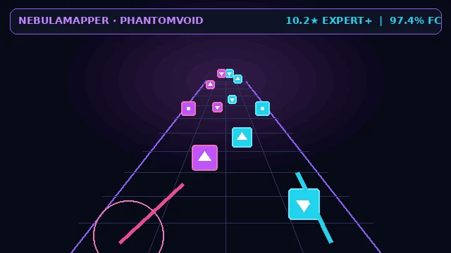
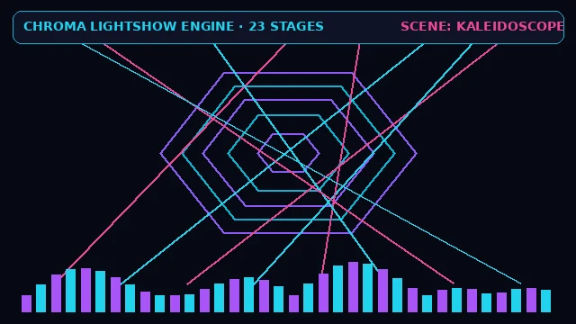
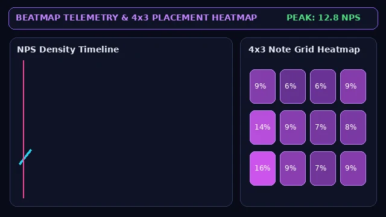
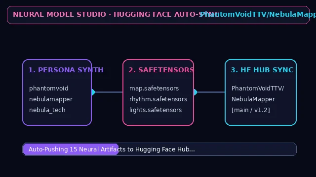

<p align="center"></p>

<p align="center"><b>NebulaMapper — PhantomVoid Neural BeatStudio</b><br>Neural Beat Saber Map Architecture, Chroma Lightshow Choreography, Autonomous 6-DoF VR Bot Replays & Hugging Face Model Forge.</p>

<p align="center">
  <a href="https://colab.research.google.com/github/GalaxyFSRP1/NebulaMapper/blob/main/colab.ipynb"></a>
  <a href="https://huggingface.co/PhantomVoidTTV/NebulaMapper/tree/main"></a>
  <a href="https://github.com/GalaxyFSRP1/NebulaMapper"></a>
</p>

<p align="center">
  
  
  
  
</p>

---

## 🌌 Core Capabilities

1. **⚡ Neural Map Forge & Custom Personas**
   - Generates multi-difficulty Beat Saber map packs (`.zip`) from any audio file (`.mp3`, `.wav`, `.ogg`, `.flac`, `.egg`) or YouTube URL.
   - Includes synthesized **PhantomVoid** mapper personas (`phantomvoid`, `nebulamapper`, `nebula_tech`, `nebula_speed`, `nebula_acc`) alongside 123 human mapper embeddings.
   - **Quick Mapping Signature Presets**: *Nebula Signature (PhantomVoid)*, *Tech & Angles*, *Speed / Stream*, *Acc / Precision*, and *Ranked Standard*.

2. **🎨 Custom Chroma Palettes & Audio Mastering FX (`bsgen/audio_fx.py`, `bsgen/export.py`)**
   - **Saber & Stage Color Palettes**: *Nebula (Purple & Cyan)*, *Phantom Void (Crimson & Violet)*, *Cyberpunk (Neon Pink & Electric Gold)*, and *Solar Ice (Amber & Glacier Blue)* written directly into `Info.dat`.
   - **Audio Mastering & Speed/Pitch Preprocessor**: Built-in `ffmpeg` DSP chain supporting *Nightcore (1.20x + Pitch)*, *Faster Song (1.15x)*, *Super Fast (1.25x)*, *Daycore / Chill (0.85x)*, *Bass Boost*, and *EBU R128 Loudness Normalization*.

3. **📊 Beatmap Telemetry & 4×3 Heatmap Inspector (`bsgen/analyzer.py`)**
   - Drop any Beat Saber `.zip` map to compute Estimated Star ★ / Tech / Pass ratings, Left/Right hand balance, parity reset rates, an interactive **NPS Density Timeline**, **4×3 Grid Placement Heatmap**, and **9-Direction Cut Breakdown**.

4. **🧬 Neural Model Studio & Hugging Face Auto-Sync (`bsgen/modelgen.py`, `bsgen/hf_sync.py`)**
   - Automatically pulls and syncs all 15 neural model artifacts with [`PhantomVoidTTV/NebulaMapper`](https://huggingface.co/PhantomVoidTTV/NebulaMapper/tree/main).
   - Synthesize custom mapper personas, blend checkpoints, fine-tune on your own `.zip` Beat Saber maps with AdamW, or initialize fresh architectures (`nano`, `small`, `base`) and push directly to Hugging Face.

---

## 🚀 Quick Start

### Option 1: Run on Google Colab (Free NVIDIA T4 GPU — Fastest)
Click the badge below to launch **NebulaMapper — PhantomVoid Neural BeatStudio** on Google Colab's free GPU with a public shareable Web UI link:

[](https://colab.research.google.com/github/GalaxyFSRP1/NebulaMapper/blob/main/colab.ipynb)

### Option 2: Run Locally (Windows / macOS / Linux)
```bash
git clone https://github.com/GalaxyFSRP1/NebulaMapper.git
cd NebulaMapper
pip install -e .
python scripts/webui.py
```
*(On Windows, you can simply double-click **`run.bat`**; on Linux/macOS, run **`./run.sh`**.)*

---

## 🛠️ Command-Line Interface (CLI)

### Forge a Beat Saber Map Pack
```bash
python scripts/generate.py \
  --audio song.mp3 \
  --stars 7.5 10.0 \
  --mapper phantomvoid \
  --color-scheme "Nebula (Purple & Cyan)" \
  --replay
```

### Synthesize / Fine-Tune Models & Push to Hugging Face
```bash
# Evolve models with custom mapper personas & push to PhantomVoidTTV/NebulaMapper
python scripts/generate_models.py --mode nebula_evolved --custom-mappers phantomvoid nebulamapper

# Fine-tune on your own Beat Saber map (.zip)
python scripts/generate_models.py --mode finetune --finetune-maps "out/my_map.zip" --train-steps 10

# Inspect Hugging Face Hub sync status
python scripts/generate_models.py --status
```

### Simulate a 6-DoF VR Bot Replay (`.bsor`)
```bash
python scripts/play.py --map "out/song 10star.zip" --diff ExpertPlus
```

---

## 🧠 Neural Architecture on [`PhantomVoidTTV/NebulaMapper`](https://huggingface.co/PhantomVoidTTV/NebulaMapper/tree/main)

| Component | Artifact | Parameters | Role |
| :--- | :--- | :--- | :--- |
| **Map Generator** | `map.safetensors`, `map.json` | 65M | Encoder-Decoder Transformer with musical memory alignment & 128 mapper personas |
| **Onset Rhythm** | `rhythm.safetensors`, `rhythm.json` | 47M | RoPE Transformer predicting exact onset hit ticks |
| **Chroma Lights** | `lights.safetensors`, `lights.json` | 7M | Environment-aware lightshow generator across 23 Beat Saber stages |
| **6-DoF VR Bot** | `player.safetensors`, `player.json` | 38M | Flow-Matching VR headset & dual-saber trajectory synthesizer (`.bsor`) |
| **Swing Labeler** | `labeler.safetensors` | 5M | Bidirectional parity & forehand/backhand reset classifier |
| **Timing & Trees** | `timing.safetensors`, `octave.npz`, `rating.npz`, `song_stars.npz` | 4M | BeatNet tempo/beat detector + Star/Tech/Pass decision forests |

## License

AGPL-3.0
